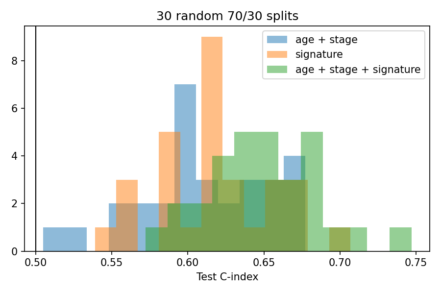

# luad-survival – leakage-free transcriptomic risk signature for lung adenocarcinoma (TCGA-LUAD)

[](https://github.com/tiagoherrador/luad-survival-signature/actions)

Python package + CLI that builds a gene-expression **risk score for overall survival** from TCGA-LUAD (UCSC Xena / GDC STAR-TPM),
and evaluates it the way it should be evaluated: every data-dependent step is fitted on the training patients only, performance is
reported on held-out patients, and compared against a clinical baseline (age + stage) over many random splits.



## Results (474 primary-tumour patients, 171 deaths; 70/30 stratified splits)

| Held-out C-index | Mean ± SD over 30 splits | Seed-42 split (95 % bootstrap CI) |
|---|---|---|
| Age + stage (Cox baseline) | 0.610 ± 0.044 | 0.668 |
| 15-gene signature alone | 0.617 ± 0.038 | 0.631 (0.538 – 0.716) |
| Age + stage + signature | **0.650 ± 0.038** | 0.661 |

- The signature alone is about as informative as age + stage, and **adds ≈ +0.04 C-index on top of them** (improves on the baseline in 27/30 splits).
  The 30 splits reuse the same 474 patients, so they are not independent evidence — there is no external validation cohort yet.
- High- vs low-risk separation is borderline: log-rank p = 0.058 on the seed-42 test set and p < 0.05 in only 1/3 of the splits.


## What is different from the exploratory notebook (`notebooks/exploratory/`)
The first version of this project (kept for reference, including the Hallmark GSEA below) reported a "very consistent" signature, but the test-set
Kaplan–Meier curves overlapped. Auditing it turned up real problems that this package fixes:

| Issue in the exploratory notebook | Fix |
|---|---|
| Signature score = plain mean of the 15 genes, mixing risk and **protective** genes (their effects cancel) | Sign-aware score: mean of train-z-scored expression × direction of each gene's hazard ratio |
| `log1p` applied to values that are already log2(TPM+1) | Values used as provided |
| Barcodes trimmed to 12 chars and duplicates averaged → **normal-tissue samples mixed with tumours** | Primary tumour samples only (sample type `01`), one per patient |
| Expression filter + top-variance selection computed on all patients | Computed on the training split only |
| Single split, one number | 30 repeated splits + clinical baseline + bootstrap CI |

## Method
1. **Data** – primary tumours, complete cases for survival, age and stage (`data.py`).
2. **Screening** – univariate Cox per gene on the training set, vectorised (Breslow ties) so all 2,000 most-variable genes are fitted in milliseconds (`cox.py`; checked against `lifelines`).
3. **Signature** – top-15 genes by p-value, direction from the HR sign; risk threshold = training median (`signature.py`).
4. **Evaluation** – C-index, log-rank, bootstrap CI, Cox baselines, repeated splits (`evaluate.py`).

## Quick start
```bash
pip install -e ".[dev]"
# download TCGA-LUAD.{clinical,survival,star_tpm}.tsv.gz from UCSC Xena (GDC TCGA-LUAD) into data/ (see data/README.md)
luad-run --data-dir data --out results --n-splits 30
pytest -q          # 8 tests: Cox vs lifelines, planted-signal recovery, null calibration, no train/test leakage
```
Outputs: `results/metrics.json`, `results/repeated_splits.csv`, `results/km_test.png`, `results/c_index_distribution.png`.

## Tests worth knowing about
- the fast Cox fit matches `lifelines.CoxPHFitter` (β and p-values);
- the pipeline recovers planted risk/protective genes **with the right signs**;
- on pure-noise expression the held-out C-index is 0.50 (null calibration across independent datasets);
- changing test-patient expression does not change the fitted signature (no leakage).

## Pathway interpretation (exploratory notebook)
Preranked GSEA of the training-set Cox ranking is dominated by **G2/M checkpoint, E2F targets and epithelial–mesenchymal transition**
(NES ≈ 2.4–2.8, FDR ≈ 0): a proliferative/mesenchymal progression axis. That analysis was run with the exploratory pipeline's preprocessing
(see table above) and is shown for context; re-running it on the corrected ranking is on the to-do list (`pip install -e ".[gsea]"`).


## Limitations / next steps
- No external validation cohort (e.g. GEO) and no time-dependent AUC yet.
- Univariate screening + top-N selection is simple; penalised Cox (elastic net) or random survival forests are natural comparisons.
- Gene IDs are Ensembl; mapping to symbols (`mygene`) is only done in the exploratory notebook.

## Author
Tiago Alejo Herrador — MIT licensed.
