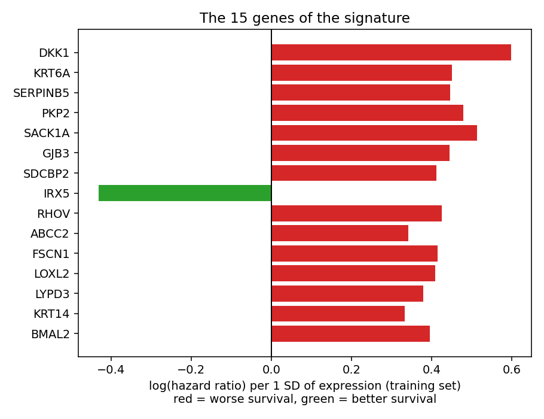
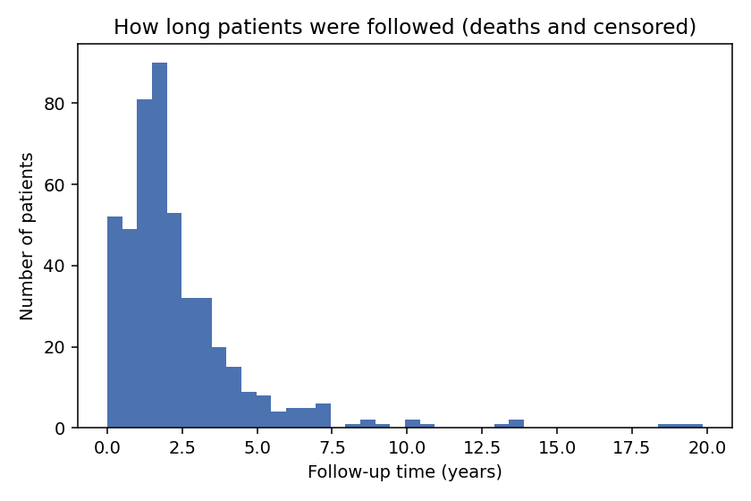
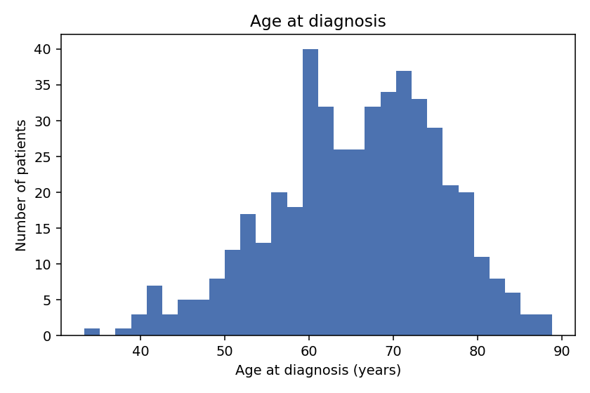
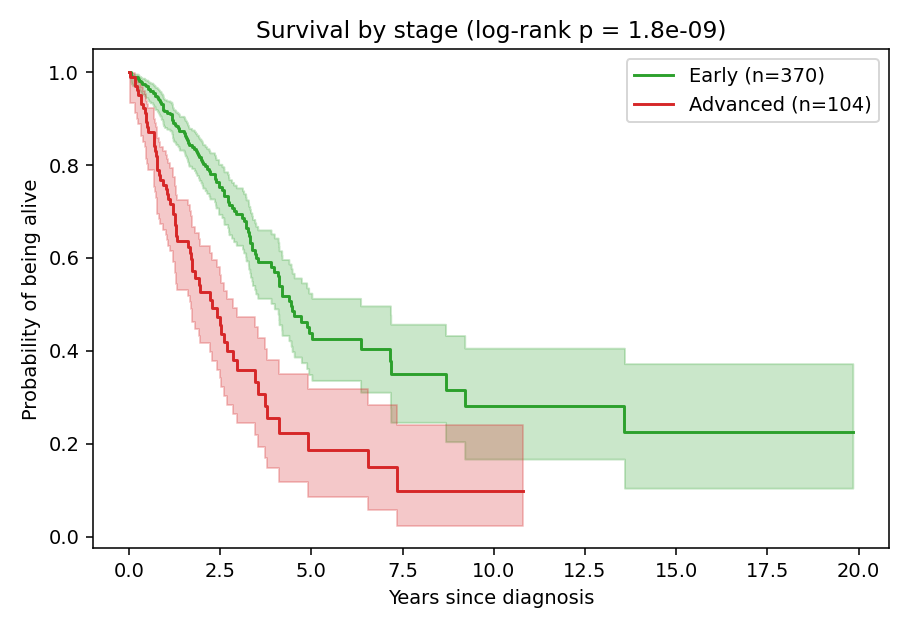
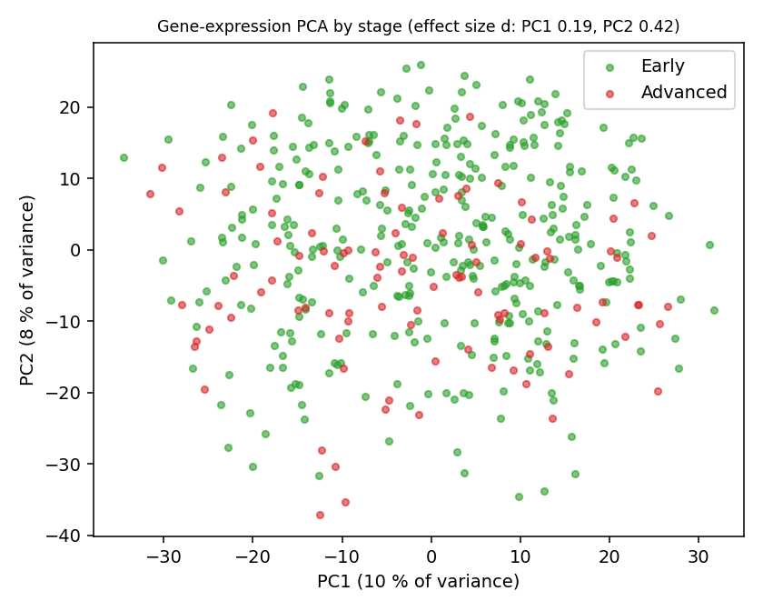
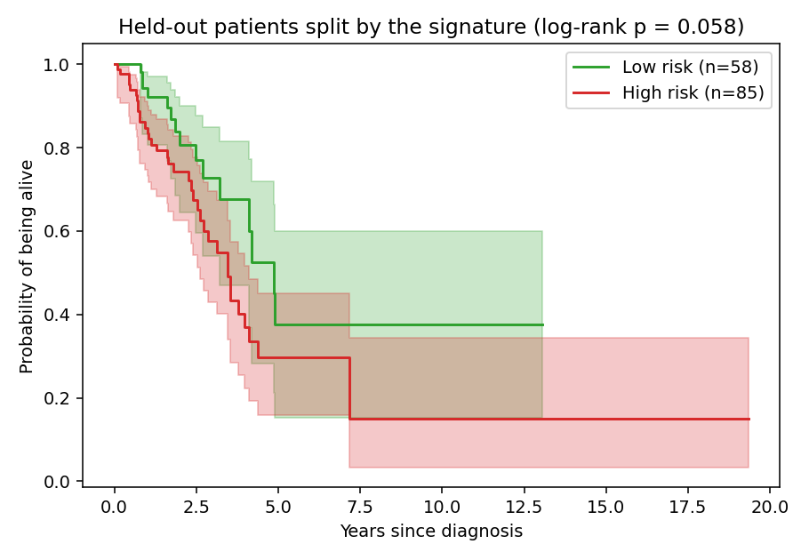
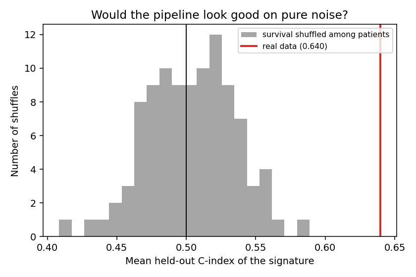
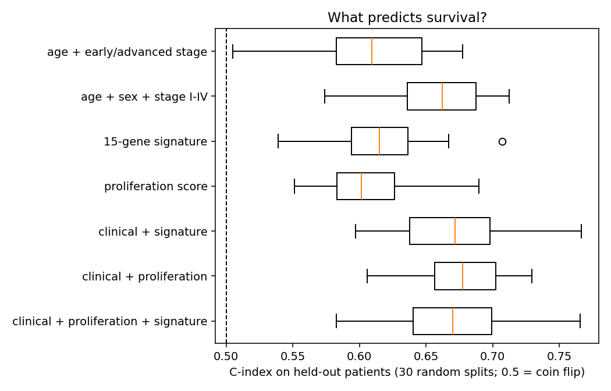
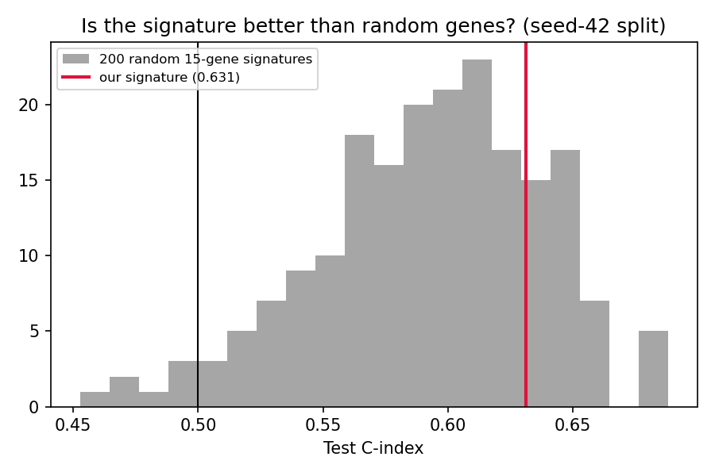
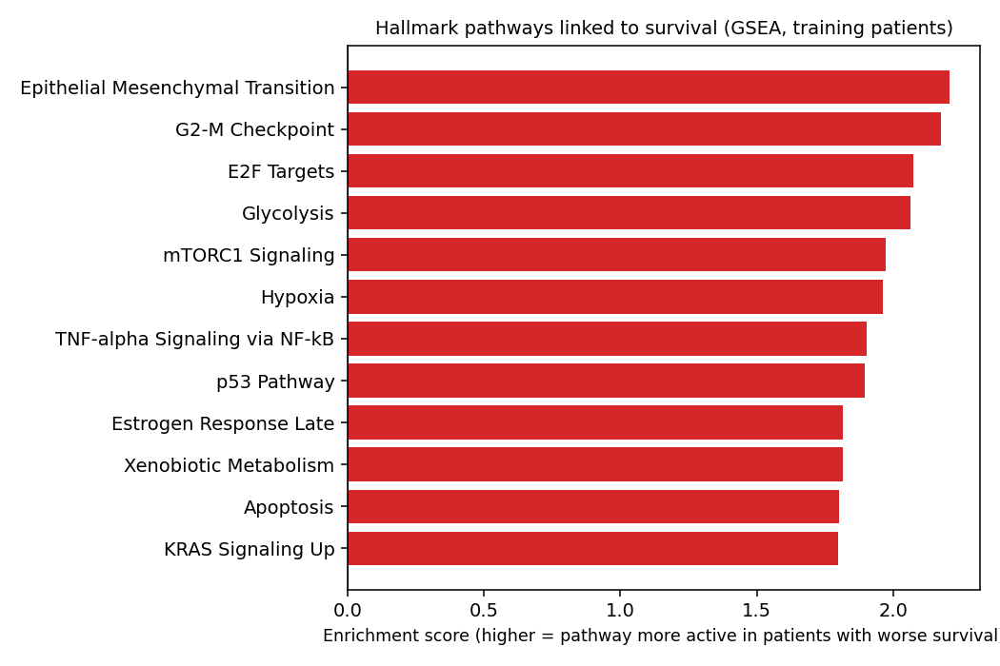

# LUAD – does a tumour's gene activity tell us anything about survival that stage doesn't?

[](https://github.com/tiagoherrador/luad-survival-signature/actions)

> **Research and portfolio project — not a medical tool.** It was built on public research data and has never been tested in a clinic. It must not be used to estimate any real person's prognosis.

## What this project is

This is an **exploratory data analysis** of the public TCGA-LUAD cohort (lung adenocarcinoma, the most common type of lung cancer), not a ready-to-use model.
Doctors already estimate a patient's outlook with the **stage** of the disease. But two patients with the same stage can do very differently, and part of the reason may be written in the tumour: **which of its ~60,000 genes are switched on, and how strongly.**

I began with a quick exploratory notebook (kept in [`notebooks/exploratory/`](notebooks/exploratory)), turned it into a tested Python package, and then did the part I find most interesting: **trying hard to break my own result.** The questions are:

1. **How much does stage tell us?** (the clinical baseline)
2. **Is there a set of genes whose activity tracks survival** — and does it still work on patients that were *not* used to find it?
3. **Does that set add anything to what stage already tells us**, or is it just a stand-in for something simpler, like how fast the tumour divides?
4. **What biology do the genes point to?**

Everything is done at the level of the **patient**, with one strict rule: a gene is only chosen using some patients (the *training* group) and judged on the others (the *held-out* group).

## The short version

| Question | What I found |
|---|---|
| Does stage predict survival? | **Yes, strongly.** Stage III vs I: hazard ratio 3.2; stage IV vs I: 3.7. |
| Do the genes carry a real signal? | **Yes, a modest one.** The 15-gene signature reaches a held-out C-index of about 0.62; if I shuffle the survival data and rerun everything, I get 0.50 ± 0.03, so it is not an artefact. |
| Do they add to a proper clinical baseline? | **Barely.** About +0.01 in C-index (age + sex + stage I–IV: 0.66 → 0.67). |
| Is the 15-gene signature special? | **No evidence of it.** A simple 12-gene "how fast is it dividing" score does as well alone, and the signature adds nothing on top of it. |
| Are those 15 genes *the* genes? | **No.** Change the training patients and the list changes: 106 different genes show up across 30 splits, none in all of them. |
| What biology is involved? | **Cell division, invasion (EMT) and metabolic adaptation** — what you would expect from aggressive tumours. |

I find this more useful than a flashy result: the signal is real, and its limits are measured rather than guessed.

## What the analysis gives you

Running it produces **figures** and **tables** (all in [`results/`](results)). For example, the signature that came out of the training patients — 15 genes, with the direction in which each one moves survival
(*hazard ratio per SD*: above 1 means patients with more activity of that gene tend to live shorter; below 1, longer):



| Gene | What it is | Effect | Hazard ratio per SD |
|---|---|---|---|
| DKK1 | dickkopf Wnt signaling pathway inhibitor 1 | worse survival | 1.82 |
| SACK1A | scaffolding CK1 anchoring protein A | worse survival | 1.67 |
| PKP2 | plakophilin 2 | worse survival | 1.61 |
| KRT6A | keratin 6A | worse survival | 1.57 |
| SERPINB5 | serpin family B member 5 | worse survival | 1.56 |
| GJB3 | gap junction protein beta 3 | worse survival | 1.56 |
| RHOV | ras homolog family member V | worse survival | 1.53 |
| FSCN1 | fascin actin-bundling protein 1 | worse survival | 1.51 |
| SDCBP2 | syndecan binding protein 2 | worse survival | 1.51 |
| LOXL2 | lysyl oxidase like 2 | worse survival | 1.51 |
| BMAL2 | basic helix-loop-helix ARNT like 2 | worse survival | 1.48 |
| LYPD3 | LY6/PLAUR domain containing 3 | worse survival | 1.46 |
| ABCC2 | ATP binding cassette subfamily C member 2 | worse survival | 1.41 |
| KRT14 | keratin 14 | worse survival | 1.40 |
| IRX5 | iroquois homeobox 5 | **better** survival | 0.65 |

The same table, with every p-value, is saved as a spreadsheet (`results/signature_genes.csv`). The other spreadsheet is **one line per held-out patient** (`results/test_risk_scores.csv`): the signature's risk score, whether the patient fell in the "high" or "low" risk group, and what actually happened to them.

| patient | follow-up (days) | died? | age | stage | risk score | risk group |
|---|---|---|---|---|---|---|
| TCGA-62-A471 | 1246 | no | 64.9 | Early | 2.03 | High risk |
| TCGA-55-7726 | 652 | no | 72.4 | Early | 1.79 | High risk |
| … | … | … | … | … | … | … |

Those 15 are the list from one particular training set; with other training patients the list changes (see step 6).

## Following the analysis step by step

Steps 1–4 are the exploration and the search for a signature. Steps 5–7 are the checks I use to decide how much to trust it.

<details>
<summary><b>Show the seven steps</b> (cohort, stage, PCA, signature, shuffling test, comparisons, pathways)</summary>

### 1. Who are the patients?

After keeping **primary tumours with complete data, one row per patient**, the cohort has **474 patients**: 171 died during follow-up and 303 were alive or lost to follow-up ("censored").
Half of the patients were followed for less than ~1.8 years, and the typical (Kaplan–Meier) survival time is about 4 years.

| Cohort | |
|---|---|
| Patients | 474 |
| Genes measured | 60,660 |
| Deaths / still alive or censored | 171 / 303 |
| Median age at diagnosis | 66.6 years |
| Women | 54.9 % |
| Median follow-up | 651 days (1.8 years) |
| Median survival time (Kaplan–Meier) | 1,454 days (4.0 years) |

| Follow-up time | Age at diagnosis |
|---|---|
|  |  |

### 2. Stage matters — a lot

I first split patients into **early** (stages I–II) and **advanced** (stages III–IV) disease.

| Group | Patients | Deaths | Median survival (Kaplan–Meier) | Median age |
|---|---|---|---|---|
| Early (I–II) | 370 | 111 (30 %) | 4.4 years | 66.7 |
| Advanced (III–IV) | 104 | 60 (58 %) | 2.3 years | 66.3 |



*How to read a survival curve (Kaplan–Meier):* each step down is a death; the line shows the share of patients still alive over time, and the shaded band is the uncertainty. The further apart two curves are, the more the groups differ.
Here the curves separate early and stay apart (log-rank test p = 2×10⁻⁹): advanced stage means a clearly worse outlook, as clinical experience says.

| Stage | Patients | Deaths | % who died |
|---|---|---|---|
| IA | 125 | 27 | 21.6 % |
| IB | 128 | 36 | 28.1 % |
| IIA | 48 | 19 | 39.6 % |
| IIB | 63 | 27 | 42.9 % |
| IIIA | 69 | 38 | 55.1 % |
| IIIB | 10 | 6 | 60.0 % |
| IV | 25 | 16 | 64.0 % |

A statistical model that looks at age, stage and sex *together* (Cox regression) confirms that **stage is the main factor**; age and sex add little. With the stage in its four levels instead of just early/advanced, the picture is sharper:

| Factor | Hazard ratio (95 % CI) | p-value |
|---|---|---|
| Stage II vs I | **2.20** (1.50 – 3.22) | 5×10⁻⁵ |
| Stage III vs I | **3.23** (2.20 – 4.76) | 3×10⁻⁹ |
| Stage IV vs I | **3.71** (2.12 – 6.52) | 5×10⁻⁶ |
| Age (per extra year) | 1.01 (0.99 – 1.03) | 0.21 |
| Female vs male | 1.04 (0.76 – 1.41) | 0.82 |

*Hazard ratio:* how many times higher the risk of dying at any moment is, compared with the reference group. 3.23 means roughly three times the risk. Age, sex and the four stage levels together rank patients with a **C-index of about 0.66** on held-out patients (see [What the metrics mean](#what-the-metrics-mean)). This is the bar any gene signature has to clear (with early/advanced stage only, it would be 0.61).

### 3. Does the whole gene-activity profile separate early from advanced tumours?

A *PCA* squeezes the 2,000 most variable genes into two summary axes, so that each patient becomes one dot. Nothing here is fitted to survival; it is just a look at the data.



Early and advanced tumours overlap a lot. The shift between the groups is small on the first axis (effect size 0.19) and small-to-moderate on the second (0.42): **stage leaves only a weak imprint on the overall gene profile**, so any survival signal in the genes will have to come from something more specific.

### 4. Looking for a 15-gene signature

I split the patients at random, **70 % for training (331) and 30 % held out (143 patients, 52 deaths)**. Using *only the training patients*:

1. every gene is tested one by one for its link with survival;
2. the 15 strongest are kept, each with its direction (risk or protective);
3. a patient's **risk score** is the average of those genes' activity, each one counted in its direction and expressed relative to the training group.

Then the score is computed for the held-out patients, who split into a **high-risk** and a **low-risk** group at the training median:



The high-risk group does worse, but the two curves overlap a lot and the difference is borderline (log-rank p = 0.058). Taking age, sex and stage into account in the same model, the signature keeps a modest effect that is only just statistically detectable:

| Factor (held-out patients only) | Hazard ratio (95 % CI) | p-value |
|---|---|---|
| Stage III vs I | 4.02 (2.01 – 8.02) | 8×10⁻⁵ |
| Stage IV vs I | 6.12 (2.19 – 17.11) | 0.0006 |
| Stage II vs I | 1.73 (0.76 – 3.92) | 0.19 |
| **Signature risk score (per SD)** | **1.34 (1.01 – 1.76)** | **0.039** |
| Age (per extra year) | 1.03 (1.00 – 1.06) | 0.063 |
| Female vs male | 0.76 (0.42 – 1.36) | 0.35 |

With only 143 patients and 52 deaths, the intervals are wide; this table is a snapshot of one split, not a firm estimate.

### 5. Is this just luck? Shuffling the survival data

A signature picked out of 2,000 candidate genes can look good on held-out patients by sheer luck. To check, I ran the **entire pipeline again 100 times after shuffling survival time and outcome among patients** — which destroys any real link between genes and survival but keeps everything else the same.



On shuffled data the held-out C-index sits at **0.50 ± 0.03** (95 % of the shuffles stayed below 0.56); on the real data it is **0.64** (average of the first five splits). So the pipeline is not manufacturing performance out of nothing (p ≈ 0.01, the smallest p-value that 100 shuffles can give): **the genes do carry some real signal about survival.** The next question is whether that signal is *new*.

### 6. Does the signature add anything? How it compares

A single random split can be lucky, so I repeated the whole procedure on **30 different random splits** and compared several predictors on the held-out patients with the **C-index**:

| Held-out C-index | Average over 30 splits (± variation) |
|---|---|
| Age + early/advanced stage (a simpler baseline) | 0.610 ± 0.044 |
| **Age + sex + stage I–IV (proper clinical baseline)** | **0.658 ± 0.039** |
| 15-gene signature alone | 0.617 ± 0.038 |
| Proliferation score alone (12 cell-division genes) | 0.606 ± 0.032 |
| Clinical + signature | 0.671 ± 0.039 |
| Clinical + proliferation score | 0.678 ± 0.029 |
| Clinical + proliferation + signature | 0.671 ± 0.040 |



Three things stand out:

- **With the proper baseline, the signature's gain is small:** +0.013 ± 0.036 on average, better in 20 of 30 splits. Against the simpler early/advanced baseline the gain would look like +0.04, but that is mostly the baseline being too weak, and a weak baseline flatters any gene score.
- **A plain proliferation score does the same job.** The 12-gene score (MKI67, TOP2A, BIRC5, CCNB1, CDC20, UBE2C, AURKB, TPX2, CENPF, MYBL2, CCNA2, PLK1) measures how fast cells divide. On its own it matches the signature (0.606 vs 0.617), and added to the clinical baseline it gains +0.020 (better in 24 of 30 splits). The signature and the score are moderately correlated (r ≈ 0.5).
- **On top of proliferation, the signature adds nothing:** −0.007 ± 0.036 (better in only 15 of 30 splits).

A well-known pitfall of gene signatures is that *almost any* set of genes shows some link to cancer survival, largely because the activity of many genes follows how fast the tumour is growing (shown for breast cancer by [Venet et al. 2011](docs/references.md)). So I also asked: *does my carefully selected set beat sets of 15 random genes treated exactly the same way?*



**Not clearly.** Random 15-gene sets reach an average C-index of about 0.59; mine is 0.63 on the seed-42 split, better than ~80 % of them, but on average over the 30 splits it beats 95 % of random sets in only **3 splits out of 30**.
Both checks tell the same story: the genes do carry signal, but most of it is the general "fast-growing tumour" signal that many gene sets share.

**Are these 15 genes *the* genes?** I also looked at how often each gene is picked when only the training patients change. Across the 30 splits, **106 different genes** entered the signature and **none appeared in all 30**; only 8 appeared in at least half (DKK1 in 28 splits, KRT6A in 24, SACK1A in 21, …; the full list is in `results/gene_selection_stability.csv`). In a typical training set about 100 genes pass a strict significance cut-off (one that accounts for testing thousands of genes at once), so "the top 15" is really a sample of a larger, correlated group of genes. DKK1 and KRT6A are the most reliable members.

### 7. What biology do the genes point to?

Looking beyond the 15 genes, I ranked about 1,900 genes (the most variable, well-expressed ones: the same pool the signature was picked from) by how strongly their activity relates to survival in the training patients. Then I asked which **biological programmes** (the *Hallmark* gene collections) are concentrated at the "worse survival" end — a method called *gene-set enrichment analysis* (GSEA).



| Pathway | In plain words | Enrichment score | Adjusted p-value |
|---|---|---|---|
| Epithelial–mesenchymal transition | cells loosening up and becoming able to move and invade | 2.21 | < 0.001 |
| G2-M checkpoint | cells preparing to divide | 2.18 | < 0.001 |
| E2F targets | the cell-division programme | 2.07 | < 0.001 |
| Glycolysis | tumour feeding on sugar | 2.07 | < 0.001 |
| mTORC1 signalling | growth and metabolism switch | 1.97 | 0.0003 |
| Hypoxia | adapting to low oxygen | 1.96 | 0.0002 |
| TNF-α signalling via NF-κB | inflammation and stress response | 1.90 | 0.0004 |
| p53 pathway | stress and DNA-damage response | 1.90 | 0.0003 |

17 of the 28 pathways tested were significant, all in the same direction. The picture is coherent: **fast cell division, the ability to invade, and metabolic adaptation** go with a worse outlook in LUAD — and several of the signature's own genes sit inside these programmes (for example DKK1 and LOXL2 in the invasion programme).

A second, narrower test asks whether the 15 signature genes *themselves* are enriched in some biological process. This test must be compared against the genes that *could* have been chosen (the ~1,900-gene pool), not against the whole genome, otherwise it flatters the result. Done that way, the clearest hit is **cellular component assembly** (4 of the 15 genes: KRT14, PKP2, FSCN1, RHOV; adjusted p = 0.009), followed by **intermediate-filament organisation** (KRT14 and PKP2; adjusted p = 0.04). With only 15 genes this test has very little power, so I read it as an observation, not a finding.

> **Careful with the story.** The pathway picture says *what kind of biology* tracks survival. Because proliferation-related signals show up in almost any gene set, it does not by itself prove that *these 15 genes* are special (see step 6).

</details>

## What the metrics mean

- **C-index (0.5 to 1)** — take two patients, one who died earlier than the other: how often does the predictor give the one who died earlier the higher risk? 0.5 is a coin flip, 1.0 is always right, and **0.6 to 0.7 is modest**.
- **Hazard ratio** — how many times higher the risk of dying is in one group than in another (1 = no difference).
- **Kaplan–Meier curve** — the share of patients still alive over time. **Log-rank p-value** — how likely a gap this large between two curves would be by chance alone.
- **Shuffling test (permutation)** — rerunning the whole analysis after randomly re-pairing patients with survival data. It shows what "good" looks like when there is nothing to find.
- **Enrichment score and adjusted p-value (GSEA)** — how concentrated a biological programme is at the "worse survival" end of the gene ranking, and how likely that is by chance after correcting for testing many programmes.

## Things to keep in mind

- **It is a modest effect.** C-index values around 0.6–0.7 mean the genes help a bit; they are far from a reliable predictor for an individual.
- **No external check yet.** All patients come from the same cohort (TCGA), and the 30 splits just reshuffle the same 474 people. Trying the signature on an independent group of patients is the real test of a biomarker, and the next thing I would do.
- **The list of genes is not stable.** Different training patients give different lists (step 6); I would trust the biology (proliferation, invasion, metabolism) more than any particular set of 15 genes.
- **Only some patients have all the data.** Of the patients in the files, 474 had a primary tumour sample and complete age, stage and sex.
- **Things I did not adjust for:** smoking, the tumour's genetic drivers (EGFR, KRAS…), how much of the sample is actually tumour, and the lab batch. Any of them could explain part of the signal.
- **The size of the signature (15 genes) was not tuned**: I fixed it in advance, and another size might behave differently.
- **Survival here is "overall survival"**: death from any cause, not only from lung cancer. Half of the patients were followed for less than ~1.8 years, and only 41 were followed for more than five.

## Try it yourself

Everything runs on **public data**; there is no trained model to request — the "model" is just the 15 genes above.

```bash
pip install -e ".[gsea,dev]"
# download the three TCGA-LUAD files from UCSC Xena into data/ (see data/README.md)

luad-run      --data-dir data --out results --gene-symbols   # tables and figures of steps 1-6 (a few minutes)
luad-pathways --data-dir data --out results                   # step 7 (needs internet)
pytest -q                                                      # automated tests
```
`--gene-symbols` and `luad-pathways` contact public web services (MyGene.info and Enrichr); only gene identifiers are sent, never patient data.

<details>
<summary><b>For developers</b></summary>

**Code layout** (`src/luad_survival/`): `data.py` (loading and harmonising the three Xena files: primary tumours, one row per patient, four stage levels) · `eda.py` (cohort, stage tables, Cox, PCA) · `cox.py` (vectorised univariate Cox, validated against `lifelines`) ·
`signature.py` (sign-aware score fitted on training patients only) · `proliferation.py` (12-gene cell-division score) · `evaluate.py` (held-out C-index, bootstrap CI, repeated splits, clinical/proliferation baselines, random-signature baseline, shuffling null, gene-selection stability) · `pathways.py` (GSEA and ORA with background) · `annotate.py` (gene symbols) · `plots.py` · `cli.py`, `pathways_cli.py`.

**Protocol.** 70/30 stratified split by outcome (seed 42 for the single-split figures; seeds 0–29 for the repeated analysis). Every data-dependent step — expression filter, top-2,000-variance gene selection, univariate screening, score normalisation, risk threshold (training median), proliferation-score standardisation, Cox baselines — is fitted on training patients only.
The clinical baseline is age + sex + stage I–IV (penalised Cox, 1e-3). The random-signature baseline draws 15 genes at random from the same screened pool, gives them the training-estimated directions and the same normalisation, and scores them on the held-out patients (200 draws per split).
The shuffling test permutes survival time and event jointly among patients and reruns the first five splits, 100 times (`--n-perm`).

**Tests** (`pytest -q`): the fast Cox fit matches `lifelines`; planted risk and protective genes are recovered with the right signs; on pure-noise expression the held-out C-index is 0.50 and the real signature is not an outlier among random ones; the shuffling null is centred on 0.5 and a planted signal beats it; changing test-patient expression does not change the fitted signature (no leakage); stage tables count each patient once.
The tests use small invented datasets where I know the right answer in advance.

**Design decisions and the literature behind them:** [docs/design_decisions.md](docs/design_decisions.md) · [docs/references.md](docs/references.md).

</details>

## Author
Tiago Alejo Herrador — MIT licensed.
