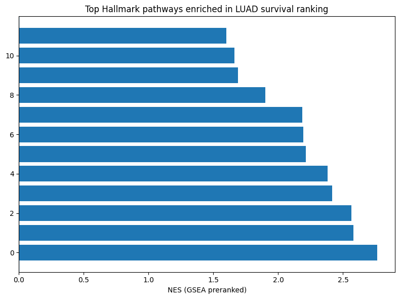
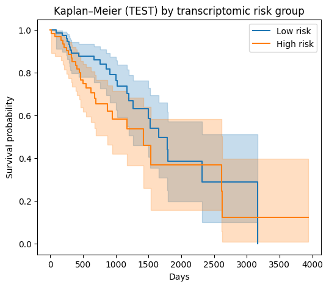

# Survival analysis and transcriptomic risk signature in lung adenocarcinoma (TCGA-LUAD)

Exploratory survival analysis of TCGA-LUAD combining clinical variables and bulk RNA-seq (STAR TPM),
with a **train/test-split** gene signature and pathway-level interpretation.



## What it does

1. **Clinical EDA** – survival-time and age distributions, early vs. advanced stage grouping.
2. **Kaplan–Meier + log-rank** by stage; **multivariate Cox** (age, stage, sex).
3. **Signature building without leakage** – 70/30 stratified split (`random_state=42`); univariate Cox screening
   on the *training* set only; a 15-gene signature score is then evaluated on the held-out set.
4. **Preranked GSEA** (`gseapy`, MSigDB Hallmark) of the training-set Cox ranking, plus Ensembl → symbol mapping (`mygene`).

## Results (honest summary)

- Stage is, as expected, strongly associated with overall survival (Kaplan–Meier by stage in `assets/km_stage.png`).
- GSEA of the survival ranking is dominated by **G2/M checkpoint, E2F targets and epithelial–mesenchymal transition**
  (NES ≈ 2.4–2.8, FDR ≈ 0), i.e. a proliferative/mesenchymal progression axis.
- The signature is **weak on held-out data**: the Cox summaries in the notebook report concordance of ≈ 0.62–0.65 and the
  test-set Kaplan–Meier curves of low vs. high risk groups overlap substantially (`assets/km_test_risk_groups.png`).
  Treat it as a hypothesis-generating exercise, not a validated biomarker.



## Reproduce

```bash
pip install -r requirements.txt
# download the three TCGA-LUAD files into data/ (see data/README.md)
jupyter notebook notebooks/luad_survival_signature.ipynb
```

> **Note:** originally developed and run in Google Colab. Google-Drive mounting cells were removed, Drive paths were rewritten as relative paths and outputs were stripped (figures of the original run are in `assets/`). The paths/cleanup were **not re-executed** after this change, so expect to adjust paths.

## Possible next steps
- Replace single split with repeated/cross-validated signature selection (or penalised Cox / elastic net).
- Add an external validation cohort (e.g. GEO) and report time-dependent AUC.
- Show gene symbols instead of Ensembl IDs in the signature plot.

## Author
Tiago Alejo Herrador
